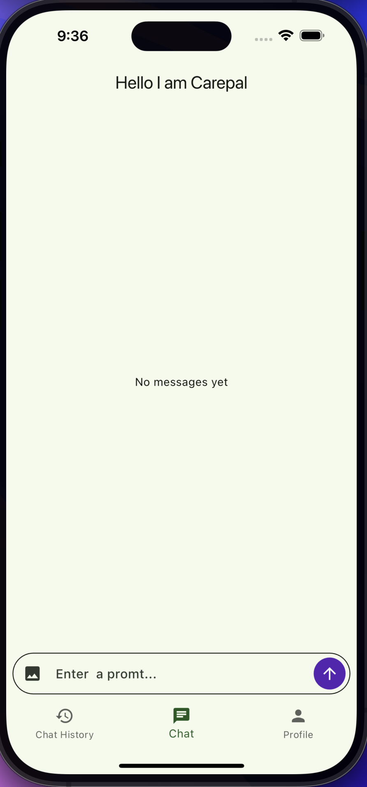
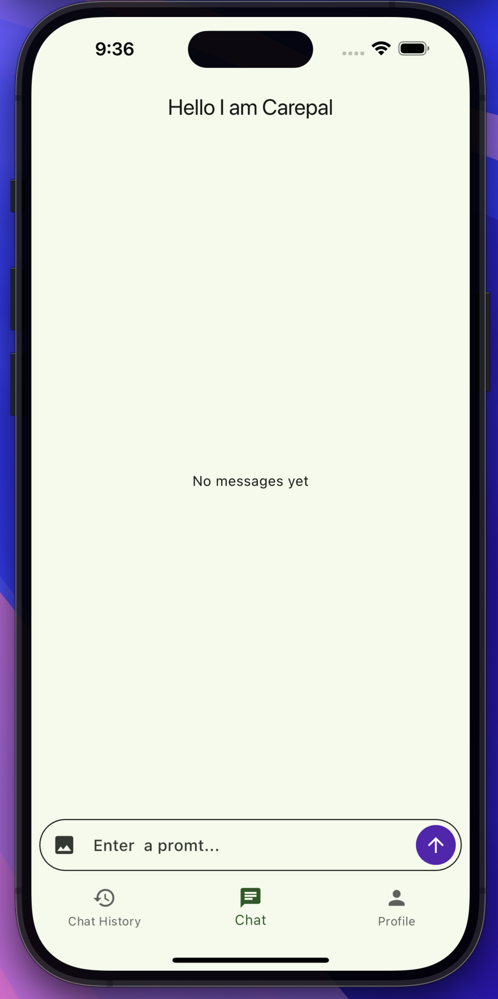
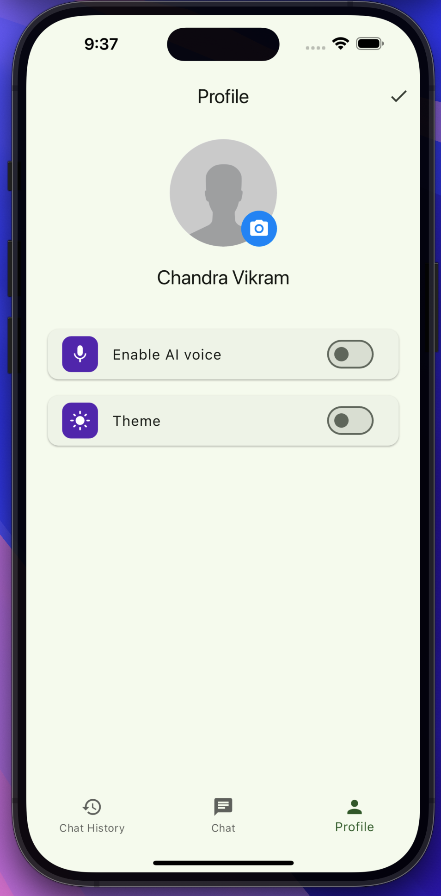
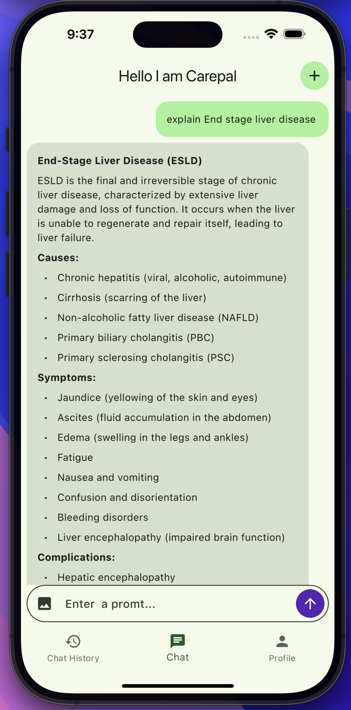

# Carepal Chatbot — Gemini-powered assistant for liver-cirrhosis patients

[](https://flutter.dev)
[](https://ai.google.dev)
[](https://pub.dev/packages/hive)
[](LICENSE)

> **Status:** 2024 prototype, the first component of the [Carepal](https://github.com/supermax01/Carepal) project
> (finalist, [2024 AMIA/HL7 FHIR App Competition](https://amia.org/education-events/amia-2024-annual-symposium/fhir-app)).
> The assistant later moved into the main Carepal app with a stricter safety prompt and secure key storage.
> Not a medical device; not for clinical use.

## What it does

- **Conversational assistant** for questions about living with liver cirrhosis, built on Google Gemini
  (`gemini-1.5-flash` and `gemini-1.0-pro` through the `google_generative_ai` SDK), using a model tuned in
  Google AI Studio on cirrhosis-related material.
- **Multimodal input**: text plus images (`image_picker`), rendered with Markdown.
- **Clinical-note summarization**: paste a de-identified note (for example from MIMIC) and get a structured summary.
- **Persistent chat history and settings** on-device with Hive; `provider` for state management; no server.

## Screenshots

<p align="center">
  
  
  
  
</p>

## Run it

```bash
git clone https://github.com/supermax01/carepal-chatbot.git
cd carepal-chatbot
flutter pub get
```

Get a Gemini API key from [Google AI Studio](https://aistudio.google.com/app/apikey) and set it in
`lib/api/api_service.dart` (replace `'your api key'`). This prototype keeps the key in a constant for local testing
only; never commit a real key. The main Carepal app reads keys from `.env` and platform secure storage instead.

```bash
flutter run
```

## Project layout

```
lib/
├── main.dart
├── api/api_service.dart      # Gemini API key holder (placeholder)
├── providers/                # chat and settings state (provider)
├── hive/                     # chat history, user, and settings boxes
├── models/                   # message model
├── screens/                  # home, chat, chat history, profile
├── widgets/                  # message bubbles, image previews, input field
└── themes/                   # app theme
```

## Related repositories

| Repo | Role in the project |
|---|---|
| [Carepal](https://github.com/supermax01/Carepal) | Main app: Gemini assistant, PROMIS-29 outcomes to REDCap, care-management screens |
| [hapi_flutter](https://github.com/supermax01/hapi_flutter) | FHIR `Patient/$everything` demo against a HAPI FHIR server |
| [carepal-emr](https://github.com/supermax01/carepal-emr) | OpenEMR SMART-on-FHIR client (OAuth 2.0 + PKCE) with a FastAPI proxy |

## License

MIT — see [LICENSE](LICENSE).
